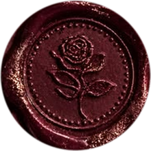
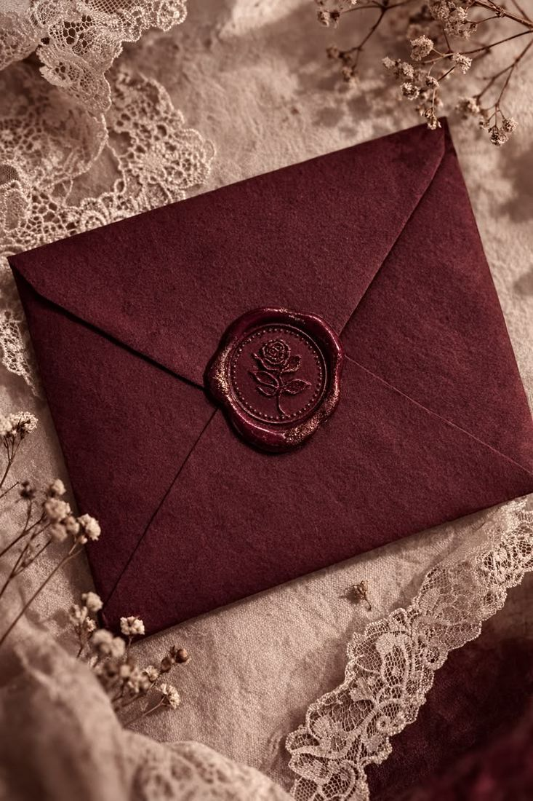
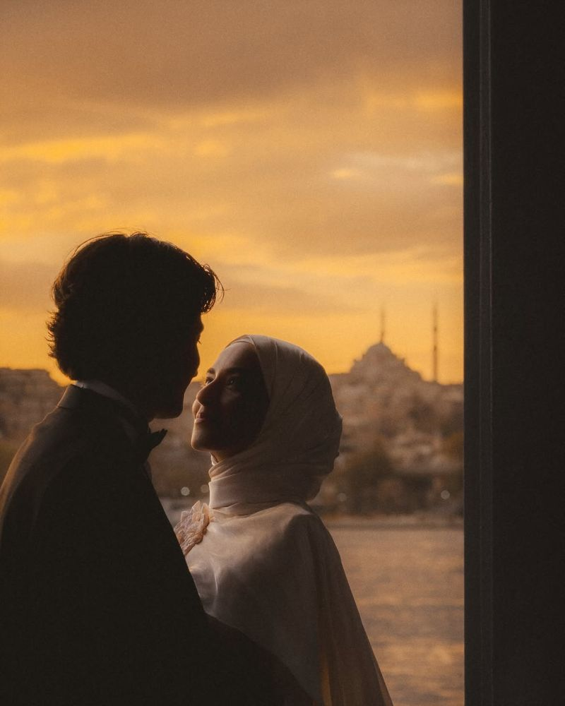
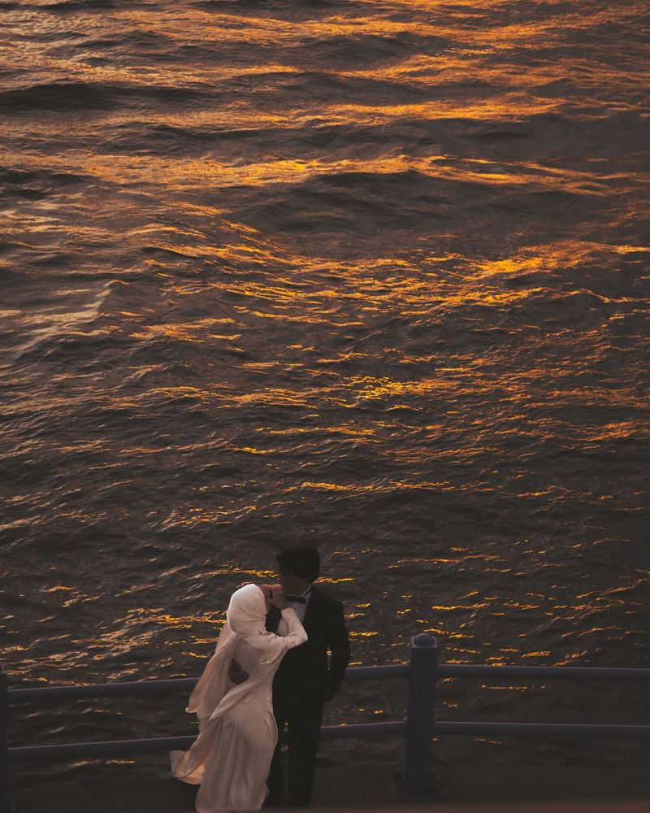
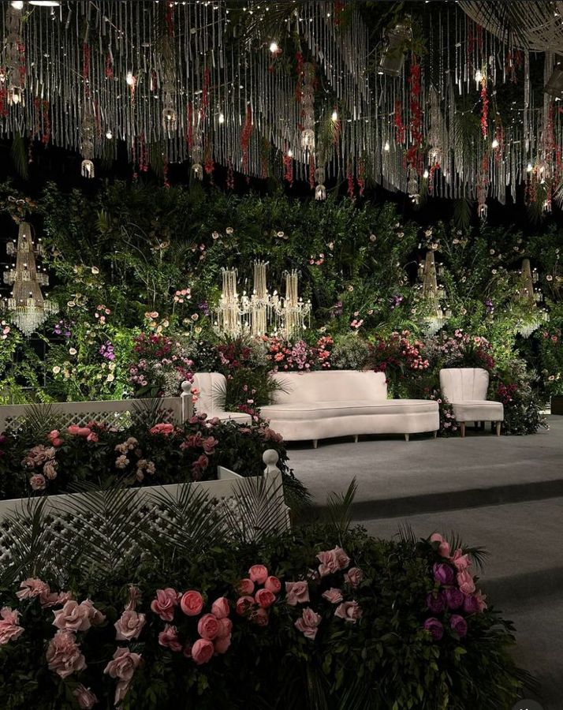
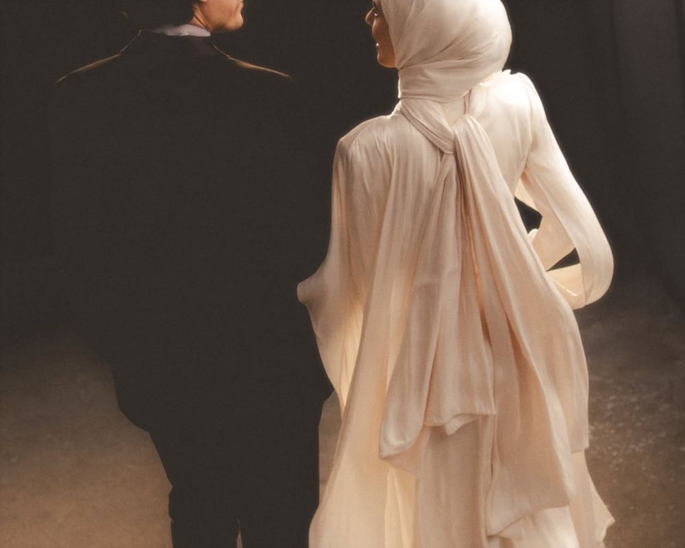
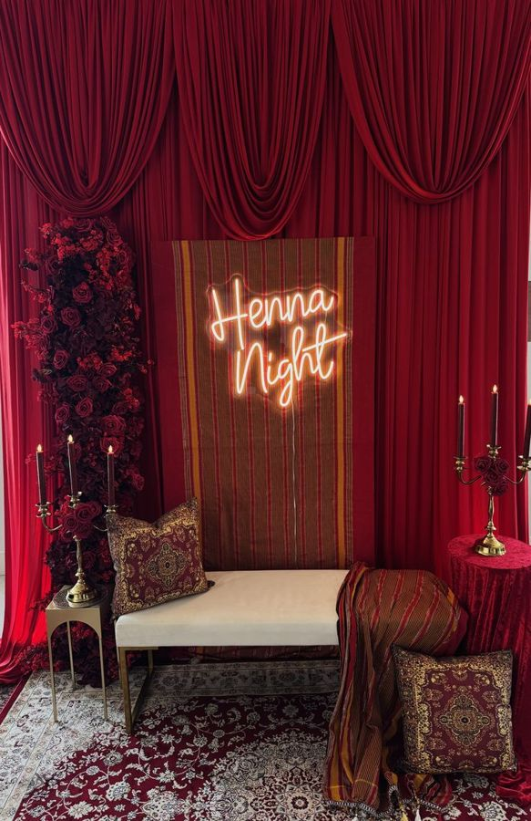
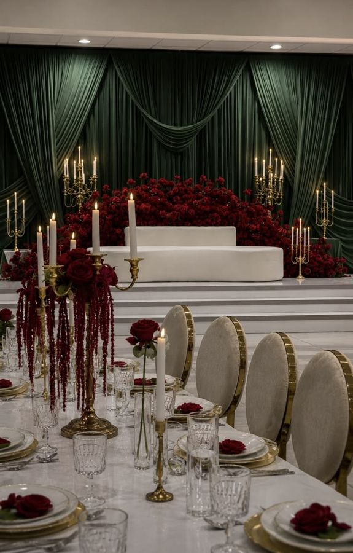
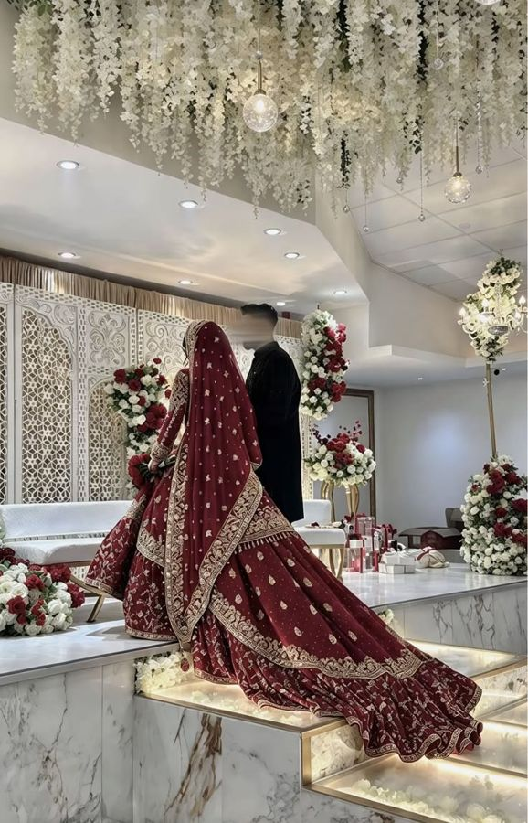
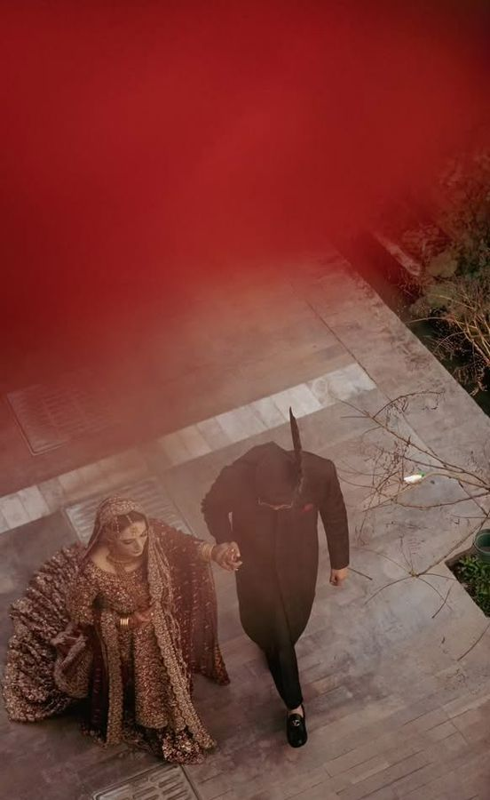

  

<h1 align="center">Amira &amp; Yusuf</h1>

  <i>A wedding invitation you open by breaking the seal.</i>

  <a href="https://amira-yusuf-wedding.vercel.app"><b>Open the invitation&nbsp;&nbsp;→</b></a> 
  Best on a phone. It's built to be held in one hand.

 

  

 

## The idea

A paper invitation comes with little rituals. You lift the envelope, crack the wax, unfold the card, and only then find out the date. Most digital invitations skip all of that and go straight to the details.

This one doesn't. It's a single web page, made as a concept for a five-day Muslim wedding, from the dholki to the walima. It keeps those small moments of opening and turns them into something you do with your thumb. The guest taps a wax seal and watches it split. They pull a tassel to unroll the date. They swipe through the events like cards on a table. Nothing shows up all at once. You find it as you go, the way you would with paper.

It was made as a design piece, not for a real event. The couple's story is told the way a real invitation would tell it.

 

## In pictures

  
  
  

<i>sunset &nbsp;·&nbsp; golden hour &nbsp;·&nbsp; the dholki</i>

 

  

<i>side by side, always</i>

 

  
  
  

<i>mehndi &nbsp;·&nbsp; baraat &nbsp;·&nbsp; bismillah to forever</i>

 

## What happens when you open it

**The envelope.** The page opens on a sealed burgundy envelope with a soft pulse around the seal. Tap it and a crack runs through the wax, the two halves fall away, and a burst of rose petals scatters across the screen. The view then zooms into the envelope and the letter appears.

**The names.** *Bismillah* sits above an arched photograph. Then the couple's names type themselves out one letter at a time, each followed by their parents' names.

**A verse.** *"And We created you in pairs"* (Surah An-Naba, 78:8), in Arabic and English.

**Pull to reveal.** The date is hidden inside a small scroll between two brass rods. Drag the tasselled rod down, or just tap it, and the paper unrolls to show *Saturday, 12 June 2027*. More petals fall. A live countdown starts, with an *Add to calendar* link.

**Five days, five cards.** Dholki, Mehndi, Nikah, Baraat and Walima are stacked like a deck. You swipe them away or step through with the arrows. Tap a card and a sheet slides up with the venue, the host family, a short note and the dress code, shown as small colour swatches. Each event has its own directions and calendar link.

**After the nikah.** Photographs from the nikah shoot sit in a coverflow of polaroid-style prints, each with a handwritten caption. It moves on its own when it's on screen, pauses when you touch it, and opens into a full-screen viewer you can swipe through.

**How to reach.** A hand-drawn map of Palm Beach, made in SVG, marks the venue with a pulsing wax seal. Below it are Google Maps and Apple Maps links and a few notes on flights, parking and rooms.

**RSVP.** Name, yes or no, number of guests, a note for the couple. There's no server. Sending the form writes a reply for you and opens it in WhatsApp, ready to send.

**Small things.** A few petals keep drifting down the page while you read. The background has a faint paper grain. Sections fade in as you scroll to them. If your device asks for reduced motion, the decoration calms down. You can open the scroll with the keyboard, and Escape closes any open panel.

 

## How it's made

One `index.html` and a folder of images. No framework, no build step, no dependencies.

- **HTML and CSS.** All layout, the envelope, the scroll, the cards and the animations. The paper texture is an SVG noise filter tucked into a CSS variable.
- **Vanilla JavaScript.** Pointer Events handle the dragging and swiping, and an `IntersectionObserver` triggers the scroll reveals.
- **Canvas 2D.** The falling rose petals, each drawn with bezier curves and a little shading.
- **Inline SVG.** The wax crack, the map, the arrows and the icons.
- **Google Fonts.** Cormorant Garamond and Cormorant SC for the text, Pinyon Script for the flourishes, La Belle Aurore for the handwritten captions, and Amiri for the Arabic.
- **Vercel.** Hosts it as a static site, straight from this repository.

To run it locally, open `index.html` in a browser.

 

## The thinking behind it

The palette comes from the envelope: deep wine, rose, linen and a touch of brass. The type is chosen to read like something printed and then signed by hand. Every interaction does something a paper invitation would do. You break a seal, pull a scroll open, leaf through cards and pass round photographs. The page stays narrow and quiet so the photographs and the words carry it.

The aim was an invitation that feels like it was made for the guest holding it, and that's worth opening slowly.

 

  

  <i>With love and duas.</i> 
  <a href="https://amira-yusuf-wedding.vercel.app">amira-yusuf-wedding.vercel.app</a>

